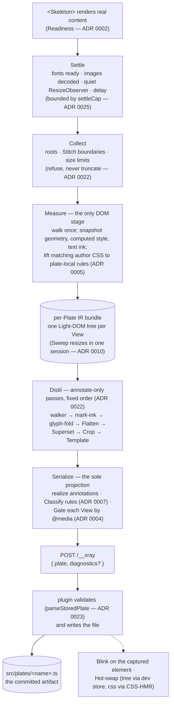
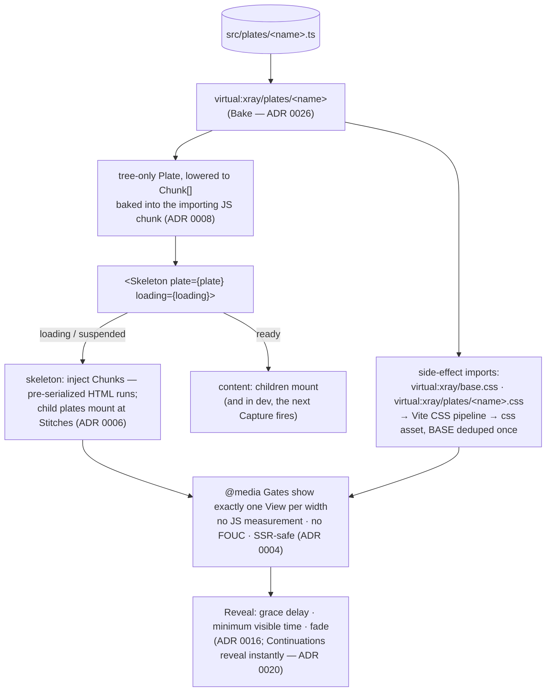

xray captures the real rendered DOM of components during normal browsing of the
dev server and renders faithful skeleton loading states from those captures.
Placeholders are captured rather than hand-drawn, with no separate headless
browser and no fixed-height or absolute-positioning hacks.

The system is two halves joined by one artifact:

1. **Capture** (dev only) turns a live component subtree into a committed
   `src/plates/<name>.ts` file, the Plate.
2. **Render** (dev and production) turns that file into the skeleton on the
   page.

Everything else — the Vite plugin, the HUD, theming, validation — serves one of
those two halves. The why behind each decision lives in [`docs/adr`](https://github.com/hueest/xray/tree/main/docs/adr);
the language lives in the [glossary](/glossary/); what's next lives in the
[roadmap](/roadmap/).

xray is a from-scratch alternative to
[boneyard](https://github.com/0xGF/boneyard), departing from it on two points.
boneyard stores flat `{x,y,w,h}` rectangles and replays them
absolutely-positioned, which forces a hardcoded container height and drifts from
the real layout; xray captures structural DOM plus scoped CSS, so the skeleton
reflows like the real thing. And boneyard drives a separate headless or
CDP-attached browser; xray captures from the browser session already in use.

## Capture: from live DOM to the Plate on disk



Capture is triggered by Readiness alone: the same condition that swaps the
skeleton for content also fires the capture, so what the user sees ready is
exactly what gets captured (ADR 0002). Settle then waits for the subtree to
stop moving, bounded by `settleCap` so a permanently busy subtree still
captures (ADR 0025).

The stages after Settle:

- **Collect** decides what enters the capture: which elements are roots, where
  the walk stops (a nested `<Skeleton>` becomes a Stitch reference, never
  descended into — ADR 0006), and the breadth/depth/node limits past which the
  capture is refused rather than trimmed.
- **Measure** is the only stage that touches the browser. It walks the subtree
  once, snapshots each node's geometry, text ink, and a frozen subset of its
  computed style onto the Light-DOM IR, and lifts the author CSS rules that
  matched each node, rewritten to plate-local identifiers with the cascade
  preserved by specificity and source order (ADR 0005, 0021, 0022). No later
  stage can read the DOM: the IR carries no live style object.
- **Distil** pares the IR down with pure annotate-only passes in a fixed
  order: measure faithfully, drop the imperceptible, compress what remains. The
  Walker applies author customization (ADR 0018); mark-ink classifies what each
  node paints; glyph-fold folds letter-sized inline marks into their text Run;
  Flatten collapses geometry-redundant wrapper chains; Superset drops Bones
  covered by a solid Bone; Crop drops Bones past the fold on both axes;
  Template collapses uniform sibling runs to one cell plus a count. Passes only
  set Annotations; none mutates the tree (ADR 0022).
- **Serialize** is the one place structure changes. It realizes every
  Annotation, content-addresses the rules into per-plate classes (Classify,
  ADR 0007), and attaches the `@media` Gate that confines each View to the
  width range it owns (ADR 0004). It runs in the browser over the whole
  bundle, so the analysis-only geometry never crosses the wire.

A Plate covers multiple Views. The Sweep (pressing record with the dev-only
extension connected — ADR 0010, ADR 0030) resizes the viewport through every
derived width band in one Session, appending one measured tree per View into
the same bundle — including empty Views for bands where a component is absent
or renders nothing — and ends the Session itself on success. Breakpoints are
derived from matching `@media` rules plus intercepted `matchMedia` calls, and
Serialize folds identical adjacent Views and prunes the boundaries between
them (ADR 0029); there is no breakpoints config.

The dev server's `POST /__xray` endpoint treats every payload as untrusted: one
structural validator (`parseStoredPlate`) guards both the POST and disk reads,
size and depth caps bound the payload, and a `css` blob that could terminate a
`<style>` element is rejected at the door and escaped again at render
(ADR 0023). Diagnostics — records of anything the capture silently gave up —
ride a sibling field and are logged, never written to disk (ADR 0024).

Browse-time capture runs as a session: the HUD's Capture toggle starts it,
captures accumulate per Site and View while browsing and resizing, and stopping
the toggle writes each buffered plate. A successful write triggers the Blink on
the captured element and Hot-swaps mounted skeletons — the tree through the dev
store, the css through CSS-HMR — with no page reload and no capture re-fire
(ADR 0026).

## Render: from the Plate on disk to the page



Importing `virtual:xray/plates/<name>` resolves to a module that Bakes the
committed file into the importer's chunk: a tree-only default export plus two
side-effect css imports. The tree is lowered to `Chunk[]` at the ship boundary,
so an adapter injects opaque HTML strings instead of walking a tree, and no
per-framework serializer reaches the client (ADR 0008). The css — the plate's
scoped rules plus the shared BASE stylesheet — travels through Vite's own CSS
pipeline into ordinary css assets: cacheable independently of code, extracted
per chunk, BASE deduped once per page by module identity (ADR 0026). Adapters
inject no styles.

At runtime, `<Skeleton plate>` shows the skeleton while `loading` or suspended
and the children when ready; children never mount without data (ADR 0002). The
browser's media engine picks the View for the current width through the carried
Gates — no JS width measurement, no flash of unstyled bones, and the same markup
on server and client, so the render is SSR-safe. Display timing is pure CSS: a
grace delay means fast loads never show a skeleton, a minimum visible time
prevents a blink once shown, and a Skeleton that replaces a still-visible
Stitch (a Continuation) reveals instantly instead of re-paying the delay
(ADR 0016, 0020).

Plates captured at runtime through `@hueest/xray/core` — outside the plugin —
carry their css explicitly instead: `captureElement` returns `{ plate, css }`,
and `renderPlateHtml(plate, composeCss(css))` or
`<Skeleton css={composeCss(css)}>` renders them.

## Core model

- **Plate vs Skeleton.** A Plate is the stored structural capture; a Skeleton is
  the runtime, on-screen placeholder rendered from it. The two never share a word (the [glossary](/glossary/) enforces it).
- **Plate passed by reference** ([ADR 0001](https://github.com/hueest/xray/blob/main/docs/adr/0001-plates-passed-by-reference.md)).
  A component imports its Plate from `virtual:xray/plates/<name>` and hands it
  to `<Skeleton>`. The Plate carries its own identity: no name registry, no
  `name` string wired across call sites.
- **Readiness drives display and capture** ([ADR 0002](https://github.com/hueest/xray/blob/main/docs/adr/0002-readiness-drives-display-and-capture.md)).
  `loading` gates whether children mount; opt-in `suspense` catches the mounted
  children while they resolve. There is no separate capture trigger.
- **A Plate is self-contained, as two artifacts** ([ADR 0003](https://github.com/hueest/xray/blob/main/docs/adr/0003-self-contained-plates.md),
  [ADR 0026](https://github.com/hueest/xray/blob/main/docs/adr/0026-two-artifact-css-via-vite-pipeline.md)): a tree-only
  `Plate` plus an independent scoped CSS string (including `@media`), under
  plate-local identifiers, depending on nothing in the consumer's build.
- **One Plate, many Views, gated by `@media`** ([ADR 0004](https://github.com/hueest/xray/blob/main/docs/adr/0004-dynamic-breakpoint-derivation.md)).
  Each View is captured and kept whole, shown only across the width range it
  owns. Views are never merged into one tree: alignment of divergent DOMs
  corrupts.
- **Plate CSS is copied author rules** ([ADR 0005](https://github.com/hueest/xray/blob/main/docs/adr/0005-css-extraction-copies-author-rules.md)),
  not frozen computed styles: copied rules reflow correctly across viewports
  where frozen values do not.
- **Every `<Skeleton>` boundary is a Stitch** ([ADR 0006](https://github.com/hueest/xray/blob/main/docs/adr/0006-skeletons-are-capture-stitches.md)).
  A parent Plate references child Plates by name and never re-serializes them;
  the Stitch is the unit of capture, edit, and Hot-swap.
- **Content-addressed node classes** ([ADR 0007](https://github.com/hueest/xray/blob/main/docs/adr/0007-content-addressed-style-classes.md))
  make rendering a node "an element with a `className`," which is what keeps
  adapters thin.

## Integration surface

An app touches xray in exactly two places: the plugin in `vite.config.ts`, and
one `<Skeleton plate={plate}>` per capture Site, with the plate imported from
`virtual:xray/plates/<name>`.

```tsx
import { Skeleton } from '@hueest/xray/react' // real module — the component
import plate from 'virtual:xray/plates/my-banner' // virtual module — the Plate
;<Skeleton plate={plate} loading={loading}>
  <RealBanner data={data} />
</Skeleton>
```

Everything else follows from that pair: the plate name comes from the import
specifier, capture opt-in is passing `plate`, and per-Site tuning (settle
delay, capture Walker, Collect limits) rides `<Skeleton>` props. Deliberately
not configurable: breakpoints (derived), the `virtual:xray/plates/` namespace,
capture naming, and per-component include/exclude lists.

Props, plugin options, and the core API live in the API Reference section,
generated from source.

## The Vite plugin

Two plugins ship in one call (the vite-plugin-pwa pattern):

- **`xray:data`** (always on) owns the virtual modules in dev and build:
  `resolveId`/`load` read the committed `src/plates/<name>.ts` and emit the Bake:
  a tree-only default export plus the `base.css` and Plate `.css` imports.
- **`xray:dev`** (`apply: 'serve'`) owns all capture machinery and is excluded
  from production builds: it injects the dev client via `transformIndexHtml`,
  serves `POST /__xray` via `configureServer`, and aliases
  `@hueest/xray/react` → `@hueest/xray/react/dev` so the dev adapter (Light
  Box, Hot-swap, capture) exists only under `serve`. Builds fall through to the
  production adapter ([ADR 0008](https://github.com/hueest/xray/blob/main/docs/adr/0008-framework-agnostic-core-thin-adapters.md)).

Neither virtual module uses `this.addWatchFile`: a capture writes the plate
file, and watching it would loop. A plates-dir watcher covers hand edits and
git checkouts instead. On every plate write, both virtual modules are
invalidated, but only the `.css` module is HMR-reloaded — a live tree re-import
would remount the capture boundary and re-fire capture
([ADR 0026](https://github.com/hueest/xray/blob/main/docs/adr/0026-two-artifact-css-via-vite-pipeline.md)).

## Dev tools

- **HUD** (opt-in): the dev deck — record and Light Box controls, the status
  ticker, and the plates list with per-plate keys and Coverage segments (which
  width bands hold a captured View and which are missing). Solid-rendered in
  its own shadow DOM
  ([ADR 0028](https://github.com/hueest/xray/blob/main/docs/adr/0028-solid-hud.md)).
- **Light Box**: flips every mounted `<Skeleton>` to its skeleton for visual
  checks — globally or per Plate. Sticky per tab via `sessionStorage`;
  seedable with `?xray-lightbox`; scriptable via
  `__XRAY__.mode.setLightbox(true)`.
- **Session**: recording. While engaged, browsing, resizing, and the Sweep's
  emulated widths accumulate captures through one path; the stop writes the
  buffered plates
  ([ADR 0027](https://github.com/hueest/xray/blob/main/docs/adr/0027-one-session-one-mode.md)).
  The Blink confirms each capture that changed a recorded result.
- **Sweep**: pressing record with the dev-only extension connected captures
  every View of every mounted Plate by driving the viewport through the
  derived width bands, then ends the Session itself
  ([ADR 0010](https://github.com/hueest/xray/blob/main/docs/adr/0010-capture-all-views-via-extension.md),
  [ADR 0030](https://github.com/hueest/xray/blob/main/docs/adr/0030-dev-bridge-protocol.md)).
- **Fixtures**: Record a Skeleton's render-input `data` into the plate module
  (its `fixture` export) and Replay it later, so hard-to-reproduce states can
  be re-captured on demand
  ([ADR 0015](https://github.com/hueest/xray/blob/main/docs/adr/0015-fixtures-dev-only-record-and-replay.md),
  [ADR 0034](https://github.com/hueest/xray/blob/main/docs/adr/0034-plate-modules.md)).

## Theming

The skeleton's appearance is driven entirely by inheritable CSS custom
properties, so consumers theme with the cascade: no props, no JS config
([ADR 0011](https://github.com/hueest/xray/blob/main/docs/adr/0011-theming-via-css-custom-properties.md)). The tokens split
into two families ([ADR 0017](https://github.com/hueest/xray/blob/main/docs/adr/0017-css-custom-property-taxonomy.md)):
`--xr-bone-*` styles an individual Bone; `--xr-skeleton-*` governs
whole-skeleton display timing ([ADR 0016](https://github.com/hueest/xray/blob/main/docs/adr/0016-skeleton-display-timing.md)).

Two architectural constraints shape the surface. Everything is progressive
enhancement: a plain bone fill plus opacity pulse is the universally supported
floor, and the only value-level features that can hard-break (`light-dark()`,
relative color) are `@supports`-guarded until Baseline Widely Available. And
the bones share one animation timeline under a `display:contents` root, which
is why a traveling shimmer and per-bone stagger are non-goals (ADR 0011); the
enter/exit swap is a separate opt-in concern (View Transitions,
[ADR 0012](https://github.com/hueest/xray/blob/main/docs/adr/0012-enter-exit-via-view-transitions.md)).

The token table and recipes live in the
[theming guide](/guides/theming/).

## Package layout

| Export / file                                | Runs in        | Responsibility                                                                                                                                                                                                                                                                                                                                                                          |
| -------------------------------------------- | -------------- | --------------------------------------------------------------------------------------------------------------------------------------------------------------------------------------------------------------------------------------------------------------------------------------------------------------------------------------------------------------------------------------- |
| `@hueest/xray` (`src/index.ts`)              | node           | the plugin(s): virtual modules, client injection, capture endpoint, HMR, the Bake                                                                                                                                                                                                                                                                                                       |
| `@hueest/xray/react` (`react.tsx`)           | browser        | prod `<Skeleton>`: timing/reveal hooks + `Suspense` + static-`refs` stitches                                                                                                                                                                                                                                                                                                            |
| `@hueest/xray/react/dev` (`react.dev.tsx`)   | browser (dev)  | dev `<Skeleton>`: Light Box, live-store Hot-swap, capture, store-subscribed stitches                                                                                                                                                                                                                                                                                                    |
| `@hueest/xray/core` (`core.ts`)              | browser        | framework-neutral capture/render surface ([ADR 0008](https://github.com/hueest/xray/blob/main/docs/adr/0008-framework-agnostic-core-thin-adapters.md)): `captureElement` runs the full pipeline in one call, `renderPlateHtml` renders a stitch-free plate — the published layer beneath the plugin & adapters                                                                          |
| `src/react.core.tsx`                         | browser        | shared render core (hook-free `renderPlate` over chunks + `useSkeletonTiming`); the contract a new adapter mirrors                                                                                                                                                                                                                                                                      |
| `src/chunk.ts`                               | node           | framework-neutral serializer: build-time tree → shipped `Chunk[]` ([ADR 0008](https://github.com/hueest/xray/blob/main/docs/adr/0008-framework-agnostic-core-thin-adapters.md))                                                                                                                                                                                                         |
| `@hueest/xray/internal/client` (`client.ts`) | browser (dev)  | internal entry point (not consumer API — the injected dev bootstrap imports it): settle + capture orchestration + `matchMedia` interception; runs Serialize and POSTs plates                                                                                                                                                                                                            |
| `@hueest/xray/internal/hud` (`hud.ts`)       | browser (dev)  | internal entry point (not consumer API — the bootstrap wires it up when `hud: true`): the dev deck (record/Light Box, Coverage, per-plate keys), Solid-rendered — ADR 0028                                                                                                                                                                                                              |
| `src/measure.ts`                             | browser        | **Measure** — the sole DOM-touching stage ([ADR 0022](https://github.com/hueest/xray/blob/main/docs/adr/0022-uniform-pass-pipeline.md) inv. 5): walks a live subtree directly into the Light-DOM IR (geometry/style/ink snapshotted); hosts `distilPlate`, which callers run before Serialize                                                                                           |
| `src/ir.ts`                                  | browser        | the Light-DOM IR (`IRNode`/`PlateIR`/`LiteStyleDeclaration`) + `emit` (IR → id-form `{tree, rules}`) and the `effective*` Annotation accessors ([ADR 0021](https://github.com/hueest/xray/blob/main/docs/adr/0021-ink-driven-grouping.md)/[0022](https://github.com/hueest/xray/blob/main/docs/adr/0022-uniform-pass-pipeline.md))                                                      |
| `src/distil.ts`                              | browser        | **Distil** — the annotate-only `IR → IR` passes in fixed order: markInk → glyph-fold → Flatten → Superset → Crop (2D) → Template (last) ([ADR 0022](https://github.com/hueest/xray/blob/main/docs/adr/0022-uniform-pass-pipeline.md) §3–4)                                                                                                                                              |
| `src/text-metrics.ts`                        | browser        | DOM text measurement (Measure layer): synthetic text bars + the `@container` line-count reflow rep via the `pretext` oracle ([ADR 0019](https://github.com/hueest/xray/blob/main/docs/adr/0019-carried-intent-and-salience-driven-capture.md) §2)                                                                                                                                       |
| `src/css-extract.ts`                         | browser        | author-CSS lift (Measure layer): flatten/index/match author stylesheets, rewrite matched rules to plate-local ids, + the carried-custom-property decision ([ADR 0005](https://github.com/hueest/xray/blob/main/docs/adr/0005-css-extraction-copies-author-rules.md)/[0007](https://github.com/hueest/xray/blob/main/docs/adr/0007-content-addressed-style-classes.md))                  |
| `src/style-cache.ts`                         | browser        | neutral leaf shared by the Measure modules: the per-capture `getComputedStyle` memo, the walk's `WalkState`, and shared low-level CSS-value helpers                                                                                                                                                                                                                                     |
| `src/serialize.ts`                           | browser        | **Serialize** ([ADR 0022](https://github.com/hueest/xray/blob/main/docs/adr/0022-uniform-pass-pipeline.md) §5): the single in-browser projection `serializePlateIR(PlateIR) → StoredPlate` — realizes Annotations, Gates Views by breakpoint, content-addresses rules (Classify, [ADR 0007](https://github.com/hueest/xray/blob/main/docs/adr/0007-content-addressed-style-classes.md)) |
| `src/breakpoints.ts`                         | browser        | View width-band derivation: `deriveBreakpoints` from matched `@media` + intercepted `matchMedia`; `viewSpanFor` maps a width to its band                                                                                                                                                                                                                                                |
| `src/classify.ts`                            | browser        | **Classify** ([ADR 0007](https://github.com/hueest/xray/blob/main/docs/adr/0007-content-addressed-style-classes.md)): content-keyed rule dedup, per-plate sequential class names, cascade-ordered emission                                                                                                                                                                              |
| `src/validate.ts`                            | node           | `parseStoredPlate` + the structural/security schema for the POST and disk reads ([ADR 0023](https://github.com/hueest/xray/blob/main/docs/adr/0023-capture-input-validation-and-plate-sanitization.md))                                                                                                                                                                                 |
| `src/diagnostics.ts`                         | browser + node | Diagnostic collection and the shared reduced-Fidelity report formatter ([ADR 0024](https://github.com/hueest/xray/blob/main/docs/adr/0024-dev-capture-diagnostics.md))                                                                                                                                                                                                                  |
| `src/blink.ts`                               | browser (dev)  | the Blink: the one-shot capture confirmation over the captured element's box                                                                                                                                                                                                                                                                                                            |
